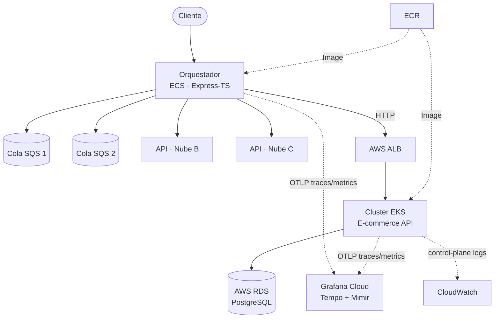

<div align="center">

# 🛍️ E-commerce API

### RESTful API for managing Clients, Commerces and Products

Project developed for the **DevOps** asignature — Universidad de Medellín

[](https://nodejs.org/)
[](https://www.typescriptlang.org/)
[](https://expressjs.com/)
[](https://orm.drizzle.team/)
[](https://aws.amazon.com/)
[](https://kubernetes.io/)
[](https://www.docker.com/)
[](https://grafana.com/)

 [Repository](https://github.com/jfpa11100/ecommerce-backend)

</div>

---

## 📋 Table of contents

- [Description](#-description)
- [Academic objective](#-academic-objective)
- [Observability](#-observability)
- [Docker](#-docker)
- [Environment variables](#-environment-variables)
- [How to run the project locally](#-how-to-run-the-project-locally)
- [Testing](#-testing)
- [Author](#-author)

---

## 📖 Description

**E-commerce API** is a RESTful API built with **Express + TypeScript**, which manages three related entities — **Clients**, **Commerces** and **Products** — using **PostgreSQL** (hosted on **AWS RDS**) as the database and **Drizzle ORM** as the data access layer.

The project follows a layered architecture (**Router → Controller → Service → Repository**) that separates responsibilities, makes testing easier, and allows the data infrastructure to evolve without affecting the business logic.

> This repository is the practical implementation of the **DevOps** emphasis track, so in addition to the application code, it includes the **cloud infrastructure, orchestration, containers, and observability stack** that support it in production.

---

## 🎯 Academic objective

Deploy a production-ready, multi-cloud application while following core DevOps and SRE practices:

| Requirement | Status |
|---|:---:|
| Git versioning with a meaningful history | ✅ |
| Standardized commits with GitMoji | ✅ |
| Complete RESTful API (includes the `QUERY` verb) | ✅ |
| At least 3 entities with real persistence | ✅ |
| Containerization with Docker | ✅ |
| Deployment on managed Kubernetes (AWS EKS) | ✅ |
| Cross-cloud orchestration (AWS ECS) | ✅ |
| Infrastructure monitoring and alerting | ✅ |
| Distributed tracing across services | ✅ |

---

## 🏗️ Architecture

This API is one of three cloud services that a Node.js **orchestrator** (deployed separately on **AWS ECS**) coordinates. The orchestrator receives requests, delegates work through two **SQS** queues, and calls three APIs hosted on three different cloud providers — this repository being the one running on **AWS EKS**.



**Request flow:** a client hits the orchestrator on ECS, which fans out work across the two SQS queues and calls the three cloud APIs — reaching this repo's API through an **Application Load Balancer** in front of the EKS cluster. This API queries **RDS** and returns the response, which flows back through the orchestrator to the client.

**Trace propagation:** every hop (HTTP calls and SQS messages) carries the OpenTelemetry `traceparent` context, so a single request can be followed end-to-end across ECS, the queues, and EKS as one connected trace in Grafana Cloud.

---

## ☁️ AWS services used

| Service | Purpose |
|---|---|
| **EKS** (Elastic Kubernetes Service) | Hosts this API as a containerized workload |
| **ECS** (Elastic Container Service) | Hosts the orchestrator service |
| **RDS** (PostgreSQL) | Managed database for this API |
| **SQS** | Two queues used by the orchestrator for async work |
| **ALB** (Application Load Balancer) | Exposes the EKS-hosted API to the orchestrator |
| **ECR** (Elastic Container Registry) | Stores the Docker images for both services |
| **IAM** | Roles and permissions for ECS tasks and EKS workloads |
| **Secrets Manager** | Stores sensitive credentials (DB, observability tokens) |
| **CloudWatch** | Selective EKS control-plane logging + CPU alarm on ECS |
| **SNS** | Sends the CloudWatch alarm notification by email |

---

## 📊 Observability

Two complementary layers of monitoring were implemented:

- **AWS CloudWatch** — selective EKS control-plane logging (`api` log type only, short retention) to keep usage within the AWS Free Tier, plus a CloudWatch Alarm on the ECS service's `CPUUtilization` that notifies an email address via **SNS**.
- **Grafana Cloud + OpenTelemetry** — both this API and the ECS orchestrator are instrumented with the OpenTelemetry Node.js SDK (auto-instrumentation for HTTP/Express and the AWS SDK), exporting traces and metrics directly via OTLP to Grafana Cloud (Tempo for traces, Mimir for metrics). Trace context is propagated through the SQS message attributes, so a request's full journey across services is visible as a single distributed trace.

---

## 🐳 Docker

The project is fully containerized with a `Dockerfile`.

```bash
# Build the image
docker build -t ecommerce-api .

# Run the container
docker run -p 3000:3000 --env-file .env ecommerce-api
```

---

## 🔐 Environment variables

Copy `.env.template` to `.env` and fill in the values:

```env
# Environment: development / test / production
NODE_ENV=

# Database (AWS RDS)
DATABASE_URL=

# Multi-cloud clusters URL:
GCP_CLUSTER_URL=
OCI_CLUSTER_URL=

# Observability (Grafana Cloud / OpenTelemetry)
OTEL_SERVICE_NAME=
OTEL_EXPORTER_OTLP_ENDPOINT=
OTEL_EXPORTER_OTLP_HEADERS=
```

---

## 💻 How to run the project locally

```bash
# 1. Clone the repository
git clone https://github.com/jfpa11100/ecommerce-api

# 2. Install dependencies
pnpm install

# 3. Set up environment variables
cp .env.template .env.development

# 4. Start the development server
pnpm dev
```

The API will be available at `http://localhost:3000`.

---

## 🧪 Testing

```bash
# Run tests
pnpm test
```

---

## 👥 Author

| Name | GitHub | Role |
|---|---|---|
| Juan Felipe Palacio | github.com/jfpa11100 | Developer |

**University:** Universidad de Medellín
**Course / Emphasis:** DevOps

Made with ☕ and lots of commits with GitMoji
